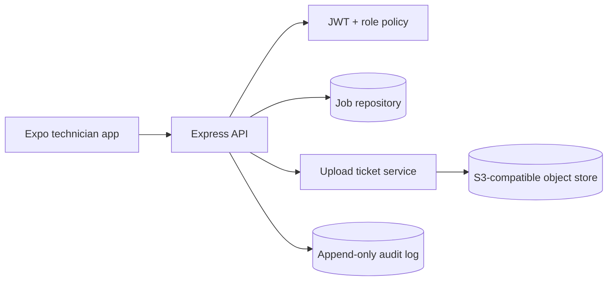
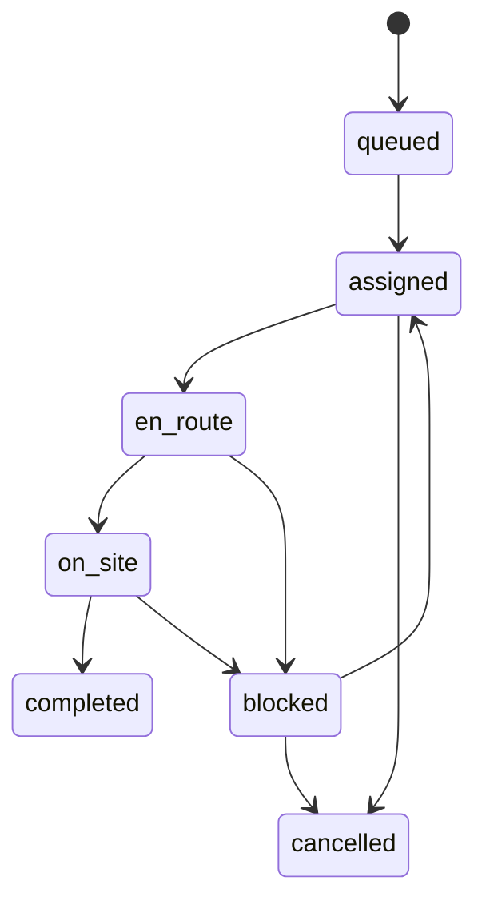

# FieldDesk

FieldDesk is a field-service operations API with dispatcher/technician roles, explicit job state transitions, auditable assignment, and signed upload tickets for site evidence. It is intentionally runnable without cloud credentials: the S3 integration is represented by a presigned-ticket boundary, so a real object-store adapter can be introduced later without changing mobile workflows.

## Architecture



## Workflow



## Structural overview

- `src/app.ts`: HTTP contracts, validation, authorization, lifecycle transitions.
- `src/db.ts`: deterministic SQLite schema for local demos.
- `src/security.ts`: password hashing and JWT issuance.
- `tests/`: API contract tests for state-machine behavior.
- `mobile/`: reserved for the Expo client; the API is designed around typed, offline-friendly transitions.

## Run

Requires Node.js 22.5 or newer because the local adapter uses the built-in `node:sqlite` module.

```bash
npm install
cp .env.example .env
npm run dev
npm test
```

## Design rationale

Explicit transitions make invalid operations observable and prevent a technician from marking an unassigned job complete. Uploads use a two-step presign/complete protocol so large media does not pass through the API process. SQLite is a local reference adapter; production deployment should use Postgres, object-store checksums, an outbox for notifications, and a background reconciliation worker.

## Security

Passwords are stored with `scrypt` and a random per-user salt; JWT signing requires a 32-character secret in production. Configure `CORS_ORIGINS` to the mobile/web origins you actually trust. The local development fallback secret and open-origin behavior are intentionally disabled by the production checks.

## Production adapters

Set `DB_URL` or `SUPABASE_DB_URL` with `POSTGRES_ROUTES_ENABLED=true` to select the async managed Postgres repository. The HTTP handlers use parameterized Postgres queries against the checked-in FieldDesk schema; local tests omit these values and use SQLite. Set `SUPABASE_URL`, `SUPABASE_SERVICE_ROLE_KEY`, and `SUPABASE_STORAGE_BUCKET` (or `STORAGE_BUCKET`) for signed uploads. The service-role key is server-only and must never be placed in the mobile client.

Startup does not run DDL against the managed database; apply the checked-in SQL migration before enabling Postgres routes.

## Operations runbooks

FieldDesk's production contracts are maintained as focused runbooks in [`docs/operations`](docs/operations/). The set covers authentication, job-state transitions, media integrity, Supabase migrations, rollout, rollback, and incident response.
