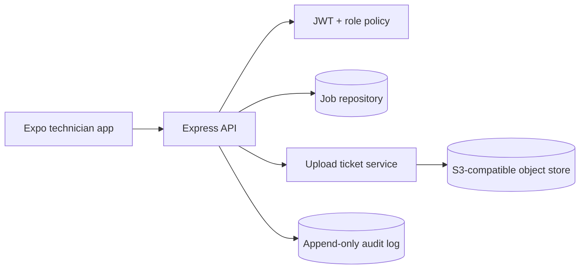
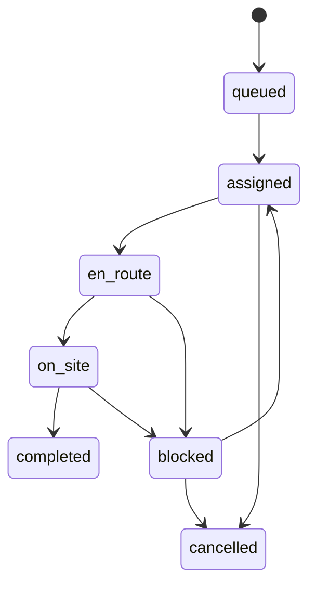

# FieldDesk

FieldDesk is a field-service operations API with dispatcher/technician roles, explicit job state transitions, auditable assignment, and signed upload tickets for site evidence. It is intentionally runnable without cloud credentials: the S3 integration is represented by a presigned-ticket boundary, so a real object-store adapter can be introduced later without changing mobile workflows.

## Architecture



## Workflow



## Structural overview

- `src/app.ts`: HTTP contracts, validation, authorization, lifecycle transitions.
- `src/db.ts`: deterministic SQLite schema for local demos.
- `src/security.ts`: password hashing and JWT issuance.
- `tests/`: API contract tests for state-machine behavior.
- `mobile/`: reserved for the Expo client; the API is designed around typed, offline-friendly transitions.

## Run

```bash
npm install
cp .env.example .env
npm run dev
npm test
```

## Design rationale

Explicit transitions make invalid operations observable and prevent a technician from marking an unassigned job complete. Uploads use a two-step presign/complete protocol so large media does not pass through the API process. SQLite is a local reference adapter; production deployment should use Postgres, object-store checksums, an outbox for notifications, and a background reconciliation worker.
